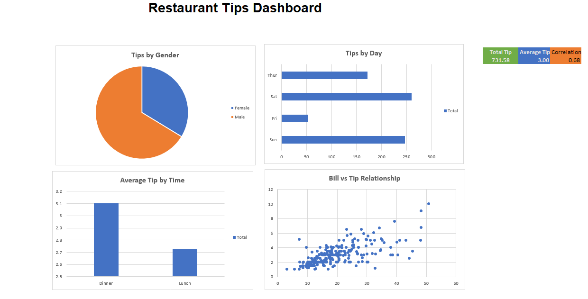

# Project 1 — E-Commerce Sales Dashboard

## Objective

Analyze e-commerce sales performance across product categories, months, and geographical regions using Microsoft Excel.

## Key Features

- Month-wise Sales and Profit analysis
- Region-wise Sales analysis
- Interactive Product Category selection
- Dynamic charts linked to analysis tables
- Organized data and analysis worksheets

## Tools and Concepts Used

- Microsoft Excel
- Pivot Tables
- Excel Charts
- Formulas
- Data Validation
- Interactive Dashboard Development

## Project Files

- `E-Commerce-Sales-Dashboard.xlsx` — Completed Excel dashboard and analysis workbook.
- `ecommerce-sales-dashboard.png` — Dashboard preview.

## Dashboard Preview

