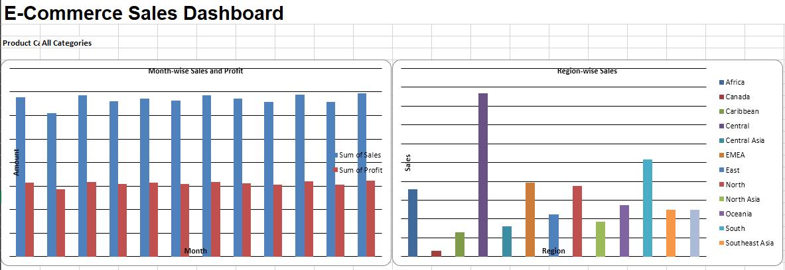

# Project 2 — Restaurant Tips Prediction

## Objective

Analyze restaurant customer tipping patterns and develop a predictive model to estimate tip amounts using Microsoft Excel.

## Key Features

- Data cleaning and duplicate checking
- Categorical variable encoding
- Gender-wise tip analysis
- Day-wise tip analysis
- Lunch vs Dinner tip comparison
- Bill and tip relationship visualization
- Correlation analysis
- Multiple regression modelling
- Predicted tip calculation

## Tools and Concepts Used

- Microsoft Excel
- IF Functions
- Pivot Tables
- Charts and Visualizations
- Correlation Analysis
- Data Analysis ToolPak
- Multiple Linear Regression

## Project Files

- `Restaurant_Tips_Dashboard.xlsx` — Completed analysis and dashboard workbook.
- `restaurant-tips-dashboard.png` — Dashboard preview.

## Dashboard Preview

