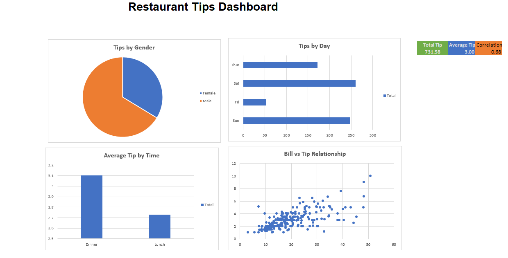
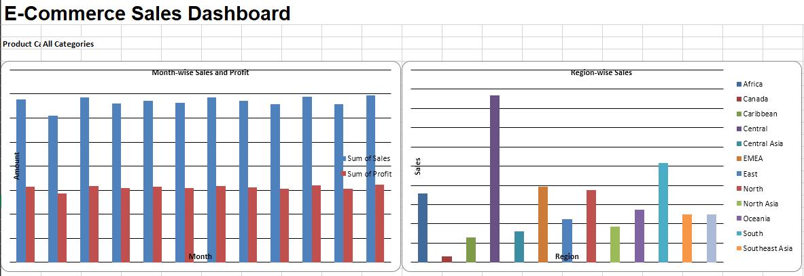

# Business Analytics with Excel Projects

This repository contains two Excel-based projects focused on exploring business data, understanding patterns, and supporting practical decisions.

## 1. E-Commerce Sales Dashboard

**Scope**

Analyzes e-commerce sales and profit across different months, product categories, and geographical regions. An interactive product-category selection and linked charts help explore the sales data from different perspectives.

**What it is used for**

- Monitor monthly sales and profit trends.
- Compare sales performance across geographical regions.
- Explore how product categories contribute to overall sales.
- Identify stronger and weaker sales periods and regions to support business planning.

**Project files:** [Excel Workbook](Project-1-E-Commerce-Sales-Dashboard/E-Commerce-Sales-Dashboard.xlsx)

**Dashboard Preview**

## 2. Restaurant Tips Prediction

**Scope**

Explores restaurant tipping patterns using customer bill and tip data. The analysis compares tips by gender, day, and meal time, examines the relationship between bill amounts and tips, and uses multiple linear regression to calculate predicted tip amounts.

**What it is used for**

- Understand how tipping patterns vary across customer groups and dining periods.
- Examine the relationship between bill amounts and tips.
- Use regression-based estimates to understand and predict tip amounts.
- Support restaurant analysis of customer tipping behaviour and service-related trends.

**Project files:** [Excel Workbook](Project-2-Restaurant-Tips-Prediction/Restaurant_Tips_Dashboard.xlsx)

**Dashboard Preview**

